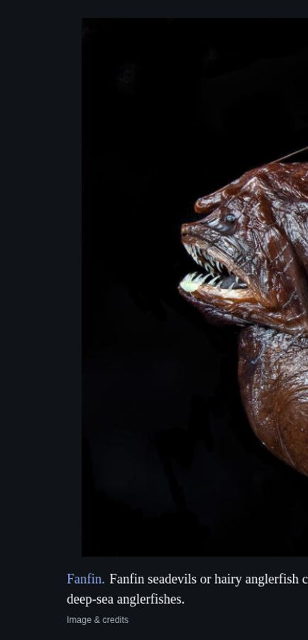

# Earth loading screen

A photograph, a caption, and somewhere else to go.

A quiet Wikipedia slideshow for a spare monitor. Leave it running while the house is asleep, or follow a subject down a rabbit hole. Plain serif text, blue links, and no repeated articles or pictures in the same browser.

**[Open the live site](https://maxplank69420-svg.github.io/earth-loading-screen/)** · [How the feeds work](docs/feeds.md) · [Contributing](CONTRIBUTING.md)



## Use it

Open the [live site](https://maxplank69420-svg.github.io/earth-loading-screen/), move the window to a spare monitor, and choose **full screen**. The small links at the bottom control the slideshow.

| Control               | What it does                                                                         |
| --------------------- | ------------------------------------------------------------------------------------ |
| **feed**              | Switch between Everything (random), Rabbit hole, and a searched Wikipedia category   |
| **speed**             | Choose 5, 15, 30, 60, 90, 180, or 300 seconds; a custom interval; or manual playback |
| **pause / next**      | Stay with a picture or move on                                                       |
| **history**           | Search, save, revisit, export, and import pictures you've seen                       |
| **dark / light mode** | Change the theme; your choice is remembered                                          |
| **settings**          | Toggle online discovery and optional slow image movement                             |

The QR code and caption link open the original Wikipedia article. **Space** pauses, **→** advances, **H** opens history, and **F** toggles full screen. Speed, feed, theme, and history stay in this browser.

## Feeds

**Everything (random)** samples Wikipedia's random-article API, then keeps entries with a usable picture and caption. It does **not** use most-read, trending, featured, or celebrity feeds. Random selection can still put similar subjects together; illustrated articles are a subset of Wikipedia, not a statistically uniform sample of everything people know.

**Rabbit hole** follows actual outgoing article links for up to three pictures, then starts somewhere random. It shares the same no-repeat record.

**Category** searches Wikipedia's live category names. Type a subject, choose a matching category, and explore its articles and subcategories. No topic names are hardcoded. This follows Wikipedia's taxonomy, which can overlap, contain surprises, or have no category matching your exact phrase. It never silently substitutes unrelated random pictures when a category is empty or offline.

See [feed selection and its limits](docs/feeds.md) for the implementation details.

## Run locally

Requires **Python 3**. No npm install, build step, API keys, or backend account.

```sh
git clone https://github.com/maxplank69420-svg/earth-loading-screen.git
cd earth-loading-screen
python3 serve.py
```

Open **http://127.0.0.1:8000**. On Windows, use `py serve.py`. To choose another port: `python3 serve.py --port 8080`.

You can also download the repository ZIP and run the same launcher. Any static web server can serve `dist/`. Opening `index.html` directly as a file won't work because the browser must fetch JSON over HTTP.

The bundled local pictures provide a small offline fallback in Random mode. Finding new articles, category browsing, rabbit holes, and remote images need internet. An exhausted collection waits instead of looping.

## Keep your history when moving hosts

History belongs to each browser origin. GitHub Pages and localhost have separate records.

1. On the old host, choose **history → Download history**.
2. On the new host, choose **history → Import history** and select the JSON file.

This restores the trail, saved pictures, and the seen record. A new host may show its first picture before you import. Clearing browser data clears the record. If storage is blocked or full, Settings explains the session-only limit. No history is sent to a server by this app.

## Host your own copy

The repository includes [a GitHub Pages workflow](.github/workflows/pages.yml). In your copy, choose **Settings → Pages → Source → GitHub Actions**, then run **Publish to GitHub Pages**. Pushes to `main` deploy automatically after tests pass. All app paths are relative, so repository subpaths work.

The production site is static. It makes direct browser requests to Wikipedia and Wikimedia; there is no ChatGPT or Sites runtime dependency.

## Development

The application is ordinary HTML, CSS, and JavaScript. Node.js 22+ is needed only for tests:

```sh
node --test tests/*.cjs
```

- `dist/app.js` — display, controls, persistence, and playback
- `dist/discovery.js` — Wikipedia API, category traversal, randomization, and history validation
- `dist/style.css` — the existing plain light/dark presentation
- `dist/stories.json` and `dist/assets/` — offline collection and vendored QR generator
- `tests/` — deterministic feed, playback, migration, and request-race checks
- `serve.py` — dependency-free local HTTP launcher

See [CONTRIBUTING.md](CONTRIBUTING.md) for the project's scope and checks.

## Sources and licenses

Captions are from [Wikipedia](https://en.wikipedia.org/) under [CC BY-SA](https://en.wikipedia.org/wiki/Wikipedia:Text_of_the_Creative_Commons_Attribution-ShareAlike_4.0_International_License). Article links provide authorship and revision history. Images have individual Wikimedia licenses: follow **Image & credits**, then the article's image, for its attribution and license. Cached pictures retain their original source URLs in `dist/stories.json`; [bundled image credits](docs/IMAGE_CREDITS.md) list the artists and individual licenses.

Original application code is [MIT licensed](LICENSE). Wikipedia text and Wikimedia pictures retain their own licenses. The QR generator is by Kazuhiko Arase and includes its [MIT license](dist/assets/qrcode-LICENSE.txt).
